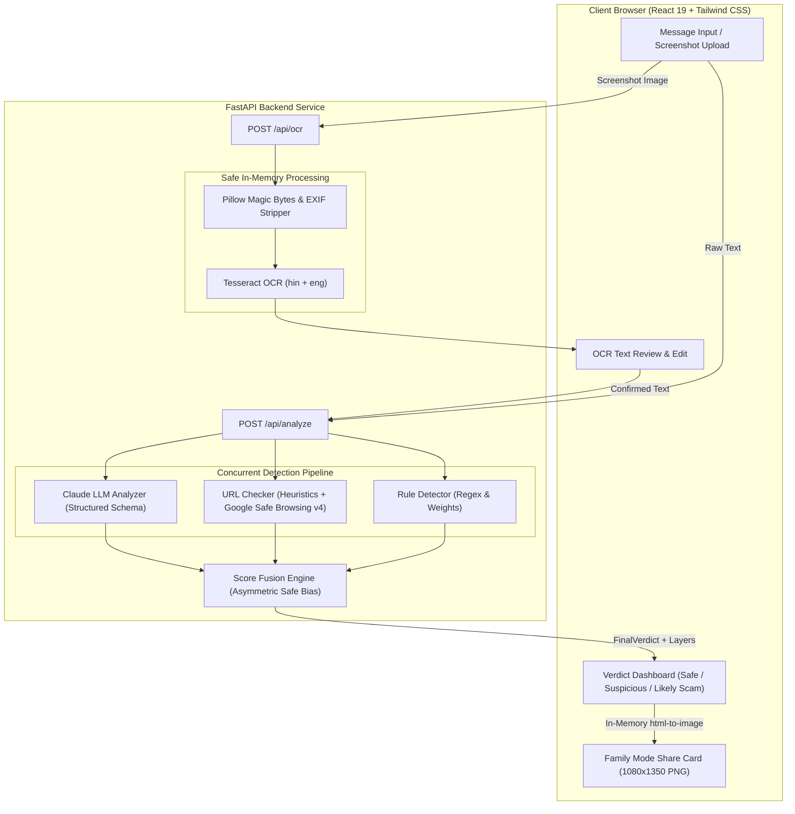

# Scam Shield 🛡️

**AI-powered scam detection and family safety guidance for India.**

Scam Shield is a privacy-first web application designed to protect citizens from prevalent cyber fraud and social engineering scams in India (such as *digital arrest*, *fake KYC updates*, *UPI refund traps*, *part-time job fraud*, and *electricity disconnection threats*). 

Users paste suspicious SMS, WhatsApp messages, or call transcripts — or upload a screenshot — to receive an instant three-tiered verdict (**Safe**, **Suspicious**, or **Likely Scam**), highlighted red flags inside their text, plain-language bilingual explanations (Hindi & English), actionable next steps (including 1930 helpline & cybercrime.gov.in), and a WhatsApp-shareable **Family Mode** warning card.

---

## 🌟 Key Features

- **Hybrid 3-Layer Detection**: Combines deterministic regular expression pattern scoring, real-time Google Safe Browsing URL intelligence with local heuristics, and Claude LLM semantic reasoning.
- **Asymmetric Safety Posture**: Prioritizes avoiding false negatives (missing a scam) over false positives. When in doubt, the system leans toward *Suspicious*, and verdicts never claim "100% safe".
- **Screenshot OCR (Hindi + English)**: Upload screenshots of SMS or WhatsApp chats. In-memory Tesseract OCR extracts bilingual Devanagari and Latin script text for user review before running analysis.
- **QR Code & UPI Scam Detection**: Decodes QR codes from uploaded images using in-memory `zxing-cpp`. Automatically parses NPCI `upi://pay` payment URIs, flags deceptive "scan-to-receive refund" traps, warns against corporate impersonation, and enforces India's Golden Rule of UPI.
- **WhatsApp Web Extension (Manifest V3)**: Chromium browser extension injects a non-intrusive `[🛡️ Check]` button onto incoming WhatsApp Web messages for instant 1-click verification directly in chat.
- **Interactive Red-Flag Highlighting**: Client-side pure React text rendering highlights deceptive spans (urgency cues, authority impersonation, financial demands) without DOM injection vulnerabilities.
- **Bilingual Accessibility**: Instant one-click toggle between plain English and Hindi (Devanagari script), tailored for elderly users with WCAG AA high-contrast design.
- **Actionable Next Steps**: Direct tap-to-call link for India's National Cyber Crime Helpline (`tel:1930`) and reporting guidance for `cybercrime.gov.in`.
- **WhatsApp-Shareable "Family Mode" Card**: In-browser generation of clean, 1080x1350 PNG cards (4:5 aspect ratio) with high legibility for forwarding to family groups, strictly omitting personal message text and phone numbers.
- **Zero-Storage Privacy Architecture**: User messages and uploaded screenshots are processed strictly in RAM and never saved to a database, written to temporary files, or retained in logs.

---

## 🏗️ Architecture



---

## 🛠️ Tech Stack

| Layer | Technologies |
|---|---|
| **Frontend** | React 19, Tailwind CSS v4, Vite, `@fontsource/noto-sans`, `@fontsource/noto-sans-devanagari`, `html-to-image` |
| **Backend** | Python 3.12+, FastAPI, Uvicorn, Pydantic v2 |
| **Detection & AI** | Anthropic Claude API (`claude-sonnet-4-20250514`), Google Safe Browsing API v4, Regular Expressions |
| **OCR Engine** | Tesseract OCR (`eng` + `hin` Devanagari models), Pillow (PIL) |
| **Testing & Quality** | Pytest, Vitest, Testing Library, Ruff, ESLint, `pip-audit`, `npm audit` |
| **Deployment** | Docker, Docker Compose, Nginx, GitHub Actions CI |

---

## 🚀 Quick Start

### Option A: Local Container Execution (Docker Compose)

The easiest way to run the entire full-stack application (frontend on port 80, backend on port 8000):

```bash
# 1. Clone repository
git clone https://github.com/your-username/scamshield.git
cd scamshield

# 2. Configure environment (optional keys; app runs in degraded mode without keys)
cp .env.example .env

# 3. Build and run containers
docker compose up --build -d

# 4. Open in browser
# Frontend: http://localhost
# Backend API Health: http://localhost:8000/health
```

### Option B: Manual Local Setup

#### Prerequisites
- Python 3.10+
- Node.js 20+
- (Optional) Tesseract OCR with `eng` and `hin` language packs installed:
  - **Debian/Ubuntu**: `sudo apt install tesseract-ocr tesseract-ocr-hin tesseract-ocr-eng`
  - **macOS**: `brew install tesseract tesseract-lang`
  - **Windows**: Download installer from UB-Mannheim and select Hindi script.

#### 1. Backend Setup
```bash
cd backend
python -m venv venv

# Windows
.\venv\Scripts\activate
# Linux/macOS
source venv/bin/activate

pip install -r requirements.txt

# Run FastAPI development server on port 8000
uvicorn app.main:app --reload --port 8000
```

#### 2. Frontend Setup
```bash
cd frontend
npm install

# Start Vite development server on port 5173
npm run dev
```
Open [http://localhost:5173](http://localhost:5173) in your browser.

---

## ⚙️ Environment Variables

Create a `.env` file in the project root:

```env
# Backend CORS Whitelist (must match your frontend domain)
FRONTEND_ORIGIN=http://localhost:5173

# External AI & Threat Intelligence APIs (Optional: graceful fallback if missing)
ANTHROPIC_API_KEY=your_anthropic_api_key_here
SAFE_BROWSING_API_KEY=your_google_safe_browsing_key_here

# LLM Tuning
ANTHROPIC_MODEL=claude-sonnet-4-20250514
LLM_ENABLED=true
LLM_TIMEOUT=30

# URL Intelligence
URL_CHECK_ENABLED=true
SAFE_BROWSING_TIMEOUT=5
```

For the frontend, specify the backend endpoint in `frontend/.env`:
```env
VITE_API_URL=http://localhost:8000
```

*See [docs/deployment.md](docs/deployment.md) for production hosting on Render, Vercel, and cloud spend cap guides.*

---

## 📡 API Reference

### 1. Analyze Message: `POST /api/analyze`
Analyzes input text across rule patterns, Claude LLM, and Google Safe Browsing URL intelligence.

**Request Body (`application/json`):**
```json
{
  "text": "URGENT: Your SBI account has been suspended due to pending KYC. Click http://sbi-update-kyc.com to avoid permanent deactivation."
}
```

**Response (`200 OK`):**
```json
{
  "verdict": {
    "verdict": "likely_scam",
    "score": 92,
    "confidence": 0.93,
    "scam_type": "fake_kyc",
    "red_flags": [
      {
        "category": "account blocked threat",
        "quote": "account has been suspended",
        "start": 13,
        "end": 39,
        "reason": "Detected pattern 'account blocked threat' (severity weight 5/5)",
        "source": "rule"
      },
      {
        "category": "suspicious link",
        "quote": "hxxp://sbi-update-kyc[.]com",
        "start": null,
        "end": null,
        "reason": "Deceptive financial institution domain spoofing",
        "source": "url_safe_browsing"
      }
    ],
    "explanation_en": "This message is a fake KYC scam. Banks never suspend accounts via SMS or demand immediate verification through unofficial links.",
    "explanation_hi": "यह संदेश एक फ़र्ज़ी KYC घोटाला है। बैंक कभी भी SMS के ज़रिए खाता बंद करने की धमकी नहीं देते।",
    "actions": [
      {
        "id": "ACT-KYC-1",
        "priority": 1,
        "step_en": "Do not click any links or share your net banking login, PIN, or OTP.",
        "step_hi": "संदेश में दिए गए किसी भी लिंक पर क्लिक न करें और न ही बैंक विवरण साझा करें।"
      },
      {
        "id": "ACT-1930",
        "priority": 2,
        "step_en": "If money was deducted, call 1930 (National Cyber Crime Helpline) immediately.",
        "step_hi": "यदि पैसे कट गए हैं, तो तुरंत 1930 पर कॉल करें।"
      }
    ],
    "disclaimer": "High-risk scam indicators detected! Do not click any links, do not send money, and report immediately to 1930 or cybercrime.gov.in."
  },
  "layers": {
    "rule": { "verdict": "likely_scam", "score": 85, "scam_type_guess": "fake_kyc" },
    "llm": { "verdict": "likely_scam", "scam_type": "fake_kyc", "confidence": 0.95 },
    "url_check": { "overall_status": "suspicious" },
    "llm_error": null,
    "url_check_error": null
  }
}
```

### 2. Extract Screenshot Text & QR Analysis: `POST /api/ocr`
Extracts text from an image using Tesseract OCR with Hindi and English language support, automatically detecting and analyzing any embedded QR codes.

**Request (`multipart/form-data`):**
- Field: `file` (PNG, JPEG, or WEBP image; max 5MB, max 25MP)

**Response (`200 OK`):**
```json
{
  "text": "[QR Code: UPI] upi://pay?pa=refund99@ybl&pn=PhonePe&am=4500.00&tn=Refund",
  "language_guess": "en",
  "confidence": 1.0,
  "low_confidence": false,
  "warnings": [],
  "qr_result": {
    "found": true,
    "qr_type": "upi",
    "verdict": "likely_scam",
    "score": 90,
    "upi_payload": {
      "payee_vpa": "refund99@ybl",
      "payee_name": "PhonePe",
      "amount": 4500.0,
      "transaction_note": "Refund"
    },
    "red_flags": [
      {
        "category": "UPI Scan-to-Receive Trap",
        "reason": "Deceptive 'Refund / Cashback' note in a debit QR code. Scanning will deduct money, NOT credit it.",
        "severity": "critical"
      }
    ],
    "safety_rule_en": "In India's UPI system, scanning a QR code or entering your UPI PIN is ONLY for SENDING money. You NEVER need to scan a QR code or enter a PIN to receive money."
  }
}
```

### 3. Dedicated QR Scam Analysis: `POST /api/analyze-qr`
Directly decodes QR codes from an uploaded screenshot or image in memory, evaluating UPI payment parameters, preset debit amounts, and phishing links.

### 4. Health Check: `GET /health`
Returns `{"status": "ok"}` for container health monitoring.

---

## 🔒 Privacy & Security Design

1. **Zero Message Storage**: User submissions are never stored in databases, flat files, or browser LocalStorage. All analysis is performed ephemerally in RAM and released upon garbage collection.
2. **De-identified Processing**: Log files strictly record request sizes, execution latencies, and status codes. Original message contents, phone numbers, names, and passwords are never logged.
3. **In-Browser Card Rendering**: The WhatsApp Family Mode card is rendered entirely inside the user's browser via `html-to-image`. No share image is uploaded to or generated on any remote server.
4. **Untrusted Upload Protection**: Images are validated using Pillow magic bytes (rejecting disguised executables), constrained to a 25 megapixel decompression-bomb threshold, stripped of EXIF metadata, and processed strictly in memory.
5. **No "100% Safe" Verdicts**: Even completely clean messages carry a mandatory caution notice: *"No red flag found, but never share OTP, PIN or money with anyone who contacts you."*

---

## 📊 Evaluation Benchmark

Scam Shield was evaluated against an untuned, held-out synthetic test suite (`backend/data/heldout_set.json`) consisting of 40 novel messages (20 scams, 20 genuine notifications; English, Hindi, and Hinglish):

| Metric | Rule Layer Only | Fused Final Verdict |
|---|---|---|
| **Overall Accuracy** | 87.50% | **92.50%** |
| **Recall (Scam Detection)** | 100.00% | **100.00%** |
| **Precision** | 80.00% | **86.96%** |
| **F1 Score** | 88.89% | **93.02%** |
| **False Negatives** | **0** | **0** |
| **False Positives** | 5 | 3 |

### Honest Error Analysis
- **Zero False Negatives**: All 20 scam messages across digital arrest, UPI refunds, electricity threats, and job scams were correctly caught.
- **3 False Positives**: Tricky genuine messages (such as an Amazon delivery PIN alert containing "PIN" and "delivery boy") were classified as *Suspicious*. This reflects Scam Shield's deliberate asymmetric safety posture: in fraud prevention, a cautious warning is preferable to allowing a fraudulent message through.

*For complete evaluation methodology and breakdown by scam type, read [docs/evaluation.md](docs/evaluation.md).*

---

## 🛣️ Roadmap & Stretch Goals

- [x] Rule-based detection with India-specific scam patterns (M1)
- [x] Multi-layer Claude LLM integration with structured JSON schemas (M2)
- [x] Interactive UI with red flag highlighting & action checklists (M2)
- [x] Screenshot OCR supporting Devanagari Hindi and English (M3)
- [x] In-browser WhatsApp Family Mode share card generator (M3)
- [x] Held-out accuracy benchmark, security hardening & Docker setup (M4)
- [x] **Stretch**: WhatsApp Web browser extension for inline scam alerts (`extension/` Manifest V3)
- [x] **Stretch**: Malicious QR code detection and UPI string parsing (`zxing-cpp` + `upi_parser`)

---

## 📜 License

Distributed under the MIT License. See `LICENSE` for more information.
